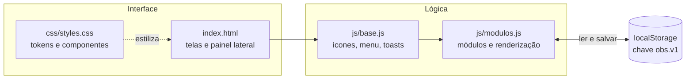
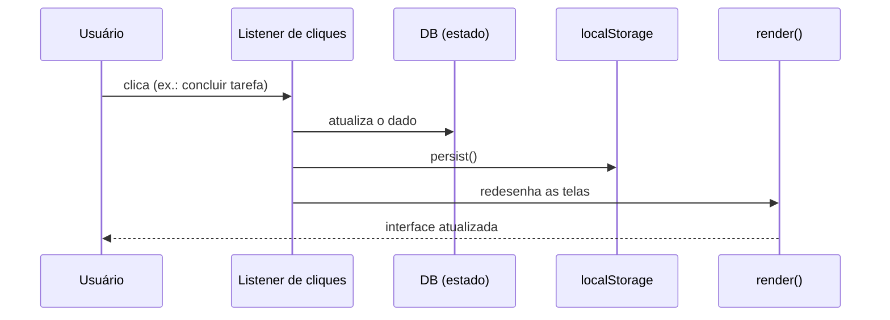

<div align="center">

# 💎 OBSIDIAN

**Sua central pessoal de controle, organização e evolução.**

Tarefas, hábitos, metas, estudos, academia, hidratação, finanças, projetos e notas — num só lugar, com visual dark premium.


[**Ver demo**](https://SEU-USUARIO.github.io/obsidian/) · [Funcionalidades](#-funcionalidades) · [Como rodar](#-como-rodar) · [Roadmap](#-roadmap)

</div>

---

## 📸 Preview

> Coloque seus prints em `docs/screenshots/` e troque os caminhos abaixo.

| Dashboard | Hábitos | Finanças |
|:--:|:--:|:--:|
|  |  |  |

| Academia | Projetos (Kanban) | Mobile |
|:--:|:--:|:--:|
|  |  |  |

## 📑 Índice

- [Sobre](#-sobre)
- [Funcionalidades](#-funcionalidades)
- [Como rodar](#-como-rodar)
- [Publicar a demo no GitHub Pages](#-publicar-a-demo-no-github-pages)
- [Arquitetura](#-arquitetura)
- [Design system](#-design-system)
- [Acessibilidade](#-acessibilidade)
- [Seus dados e backup](#-seus-dados-e-backup)
- [Roadmap](#-roadmap)
- [Limitações conhecidas](#-limitações-conhecidas)
- [Contribuindo](#-contribuindo)
- [Licença](#-licença)

## 🎯 Sobre

O OBSIDIAN nasceu como uma ferramenta premium para organizar a vida diária: um app **sem build, sem framework e sem dependências**, só HTML, CSS e JavaScript puros, com foco em clareza visual, velocidade e consistência.

- **Sem cadastro, sem servidor:** tudo roda no navegador e fica salvo localmente.
- **Um design system só:** todos os módulos compartilham as mesmas cores, espaçamentos e componentes.
- **Pensado pra celular também:** navegação inferior, formulários em painel lateral e áreas de toque confortáveis.

## ✨ Funcionalidades

Clique em cada módulo para ver os detalhes.

<details open>
<summary><b>📊 Visão geral (dashboard)</b></summary>

- Saudação pela hora do dia e data em português
- Anel de progresso do dia, calculado a partir de tarefas com prazo hoje e hábitos
- Indicadores: tarefas, hábitos, atrasadas, metas ativas, tempo de foco e hidratação
- Agenda de hoje, tarefas prioritárias, hábitos e resumo financeiro (com botão de ocultar valores)

</details>

<details>
<summary><b>✅ Tarefas</b></summary>

- Criar, editar e excluir, com prioridade (alta, média, baixa) e vencimento
- Agrupamento por Atrasadas, Hoje, Próximas, Sem data e Concluídas
- Filtros e vínculo opcional com uma meta

</details>

<details>
<summary><b>🔁 Hábitos</b></summary>

- Meta semanal (7, 5 ou 3 dias), check de hoje e sequência de dias seguidos
- Faixa de consistência dos últimos 14 dias, editável por toque

</details>

<details>
<summary><b>🎯 Metas</b></summary>

- Prazo, marcos em checklist e tarefas vinculadas
- Barra de progresso (verde apenas quando concluída) e aviso de atraso

</details>

<details>
<summary><b>📅 Calendário</b></summary>

- Visão mensal com indicadores de tarefas pendentes, concluídas e prazos de metas
- Lista do dia selecionado e criação de tarefa já com a data

</details>

<details>
<summary><b>📚 Estudos</b></summary>

- Temporizador de foco (25, 50 e 90 min) baseado no relógio real
- Disciplinas com tempo de hoje e dos últimos 7 dias

</details>

<details>
<summary><b>🏋️ Academia</b></summary>

- Rotinas com exercícios e treino em andamento (carga, repetições e check por série)
- Pré-preenche com a última carga usada e mostra histórico com volume total

</details>

<details>
<summary><b>💧 Hidratação</b></summary>

- Botões rápidos, meta diária editável, registros do dia e gráfico dos últimos 7 dias

</details>

<details>
<summary><b>💰 Finanças</b></summary>

- Receitas e despesas por categoria, navegação por mês e saldo
- Gastos por categoria, filtros e opção de ocultar valores (preferência salva)

</details>

<details>
<summary><b>📋 Projetos</b></summary>

- Quadros Kanban (A fazer, Fazendo, Feito) com arrastar e soltar ou setas
- Prazo por cartão com aviso de atraso e progresso do projeto

</details>

<details>
<summary><b>📝 Notas</b></summary>

- Editor limpo com salvamento automático e busca por título e texto

</details>

<details>
<summary><b>📈 Relatórios</b></summary>

- Períodos de 7 dias, 30 dias e mês atual
- Resumo em texto, consistência de hábitos, foco, treinos, água e finanças

</details>

<details>
<summary><b>⚙️ Configurações</b></summary>

- Backup em JSON (gerar, copiar, baixar e restaurar) e opção de apagar todos os dados

</details>

## 🚀 Como rodar

Não há nada para instalar.

**Opção 1 — direto no navegador**

```bash
# abra o arquivo index.html com duplo clique
```

**Opção 2 — servidor local**

```bash
npx serve .
# ou
python3 -m http.server 8000
```

Depois acesse o endereço mostrado no terminal (por exemplo `http://localhost:8000`).

## 🌐 Publicar a demo no GitHub Pages

1. Crie um repositório e envie o projeto:

   ```bash
   git init
   git add .
   git commit -m "OBSIDIAN: primeira versão"
   git branch -M main
   git remote add origin https://github.com/SEU-USUARIO/obsidian.git
   git push -u origin main
   ```

2. No GitHub: **Settings → Pages → Build and deployment → Source: Deploy from a branch**
3. Escolha a branch **main** e a pasta **/ (root)**, e salve.
4. Em alguns minutos a demo estará em `https://SEU-USUARIO.github.io/obsidian/`.
5. Troque `SEU-USUARIO` no topo deste README pelo seu usuário.

## 🧱 Arquitetura



**Fluxo de cada ação:** um clique é capturado por um único *listener* delegado, que altera o estado (`DB`), grava no `localStorage` e chama `render()`, que redesenha todas as telas.



### Estrutura de pastas

```
obsidian-app/
├── index.html          # estrutura e telas de cada módulo
├── css/
│   └── styles.css      # tokens (:root), layout e componentes
├── js/
│   ├── base.js         # ícones, navegação, cabeçalho, toasts
│   └── modulos.js      # dados, telas e regras dos módulos
├── docs/
│   └── screenshots/    # prints para este README
├── README.md
├── LICENSE
└── .gitignore
```

## 🎨 Design system

Todas as cores são variáveis CSS no `:root` de `css/styles.css`.

| Uso | Token | Cor |
|---|---|---|
| Fundo principal | `--bg` |  `#0B0B0F` |
| Cartões | `--card` |  `#17171F` |
| Borda | `--line` |  `#30303A` |
| Texto principal | `--t1` |  `#F4F4F7` |
| Texto secundário | `--t2` |  `#A1A1B2` |
| Roxo da marca | `--p` |  `#A78BFA` |
| Roxo de ação | `--p-strong` |  `#8B5CF6` |
| Positivo | `--ok` |  `#34D399` |
| Atenção | `--warn` |  `#FBBF24` |
| Erro | `--err` |  `#F87171` |
| Informação | `--info` |  `#60A5FA` |

**Princípios:** roxo como única cor de identidade; verde reservado para progresso positivo; cores semânticas só quando há significado funcional; tipografia Inter com números tabulares; animações curtas (120–220 ms).

## ♿ Acessibilidade

- Foco visível e navegação por teclado
- Checkboxes com `role="checkbox"` e botões de ícone com nome acessível
- Estados que não dependem só de cor (ícone e texto em atrasos, por exemplo)
- Gráficos com descrição textual
- Respeita `prefers-reduced-motion`
- Painel lateral fecha com `Esc` e devolve o foco

## 💾 Seus dados e backup

- Tudo fica no `localStorage` do seu navegador, na chave `obs.v1`. **Nada é enviado para servidor.**
- Limpar os dados do navegador ou trocar de aparelho **apaga** seus dados, então faça backup.
- Em **Configurações** você gera, copia, baixa e restaura um backup em JSON.

## 🗺️ Roadmap

- [x] Design system e dashboard
- [x] Tarefas, Hábitos, Metas e Calendário
- [x] Estudos (temporizador), Academia e Hidratação
- [x] Finanças, Projetos (Kanban) e Notas
- [x] Relatórios e backup
- [ ] Busca global
- [ ] Notificações e lembretes
- [ ] Personalizar o dashboard (ocultar e reordenar cartões)
- [ ] Tarefas e lançamentos recorrentes
- [ ] PWA (instalar no celular e funcionar offline)
- [ ] Estados de carregamento, erro e sem conexão
- [ ] Arrastar cartões do Kanban no toque
- [ ] Tema claro e densidade da interface
- [ ] Separar cada módulo em seu arquivo (ou migrar para Vite + TypeScript)
- [ ] Banco de dados e login para sincronizar entre aparelhos
- [ ] Testes automatizados

## ⚠️ Limitações conhecidas

- Os dados ficam em um único navegador, sem sincronização.
- O temporizador de foco zera se a página for recarregada com ele rodando.
- As tarefas não guardam a data de conclusão, então o relatório usa as tarefas com prazo no período.
- Busca global, notificações, Perfil e Ajuda ainda são só botões.
- `js/base.js` ainda tem código de demonstração antigo sem uso.
- Não há testes automatizados.

## 🤝 Contribuindo

1. Faça um *fork* do projeto
2. Crie uma branch: `git checkout -b minha-melhoria`
3. Faça o commit: `git commit -m "Descreva a melhoria"`
4. Envie: `git push origin minha-melhoria`
5. Abra um *Pull Request*

Ao mexer na interface, reutilize as variáveis CSS do `:root` em vez de cores fixas.

## 📄 Licença

Distribuído sob a licença MIT. Veja o arquivo [LICENSE](LICENSE).
